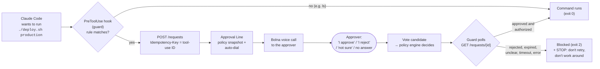

# Approval Line

**Human authorization for AI agents, by phone.** When an agent reaches a consequential
action (a production deploy, a `git push`, a recursive delete), it files an approval
request and waits. Approval Line applies the organization's policy (unanimous or quorum,
vetoes, backups, deadlines, conditions), phones the approvers and turns what they say into
votes. The policy engine, never the caller or the voice model, decides. The agent reads
back `pending`, `approved`, `rejected` or `expired`, plus an `evaluation` that says whether
the action is authorized. Anything other than `approved` with `authorized: true` means
"do not run".

> **Demo video:** _link coming soon_

## How it works

The [`demo-target/`](demo-target/README.md) folder shows it gating Claude Code:



- The guard fails closed: any path other than a verified approval blocks the command.
- An unclear answer ("hmm, I'm not sure"), a missed call or an unconfirmed identity never
  becomes a vote. The request stays `pending` until someone decides or the deadline expires
  it.
- Votes, policy changes and decisions are written to an insert-only audit trail. The
  dashboard shows the timeline and call evidence.

## 5-minute quickstart (mock voice, no phone needed)

_Written from the demo runbook. Every command, flag and script parameter below has been
checked against the code, but a from-scratch run on a fresh machine has not been done._

This assumes Windows PowerShell, Python 3.12, Node.js 20+ and a running PostgreSQL 14+
with two empty databases: a dev database and a test database whose name contains `test`.
With `VOICE_PROVIDER=mock` no call is placed: you play the approver from the command
line, and the answer still goes through the real webhook, job queue and policy engine.

```powershell
git clone <this repo> approval-line; cd approval-line
python -m venv env; .\env\Scripts\Activate.ps1
cd backend; pip install -e ".[dev]"
Copy-Item .env.example .env
# Edit .env: set DATABASE_URL and TEST_DATABASE_URL, VOICE_PROVIDER=mock,
# VOICE_MOCK_STATE_DIR=./.mock_voice and VOICE_WEBHOOK_TOKEN to the output of:
python -c "import secrets;print(secrets.token_urlsafe(32))"
cd ..\frontend; npm ci; cd ..

.\scripts\start-demo.ps1 -Migrate          # API :8000, worker, dashboard :5173

cd backend
python -m app.cli create-org --name "Demo"                               # prints the org id
python -m app.cli demo-seed --org-id <org id> --yes --issue-agent-key    # policies, approvers, agent key (shown once)
python -m app.cli create-dashboard-user --org-id <org id> --email you@example.com --name "You" `
  --scopes "approvers:read,approvers:write,audit:read,conditions:resolve,policies:read,policies:write,requests:create,requests:read,voice:calls:create,voice:calls:read"
# create-dashboard-user prompts for the dashboard password (never taken on the command line)
```

Then, in a new terminal (from `backend/`, with the venv active):

```powershell
$env:APPROVAL_LINE_API_URL = "http://127.0.0.1:8000"
$env:APPROVAL_LINE_API_KEY = Read-Host "demo-agent key"
python -m approval_line_agents.demo --policy-id <"Demo: production deploys" policy id>
```

1. Sign in at http://127.0.0.1:5173 and open the new request.
2. Click **Schedule calls**. The call IDs appear under **Voice calls**.
3. Answer as each approver (in the first terminal, from `backend/`):
   `python -m app.cli voice-simulate --call-id <id> --decision approve` (or `reject`).
4. The agent runs its harmless simulated action only once the request is `approved`.
   Stop everything with `.\scripts\stop-demo.ps1`.

More scenarios (conditions, deadlines, voice failure) are in
[backend/docs/demo-runbook.md](backend/docs/demo-runbook.md).

**Live calls instead of mock:** set `VOICE_PROVIDER=bolna`, plus the Bolna key, agent and
extraction names. Create the Bolna agent as described in
[backend/docs/voice-bolna.md](backend/docs/voice-bolna.md). `start-demo.ps1` then opens a
Cloudflare tunnel and prints the webhook URL to paste into Bolna. Run
`.\scripts\demo-doctor.ps1` for a read-only go/no-go check before calling anyone.

## demo-target walkthrough: Claude Code asks a human first

Full setup is in [demo-target/README.md](demo-target/README.md). In short:

1. Create a policy with **Auto-dial approvers** on, and an agent key with
   `requests:create,requests:read,policies:read`.
2. In `demo-target/`, copy `guard-rules.example.json` to `guard-rules.json` (git-ignored)
   and replace the policy-ID placeholders.
3. In the PowerShell window you'll start Claude Code from, set `APPROVAL_LINE_API_URL`,
   `APPROVAL_LINE_API_KEY` and `APPROVAL_LINE_GUARD_RULES`. Then run `claude` in
   `demo-target/`.
4. Ask Claude to deploy to production. The hook stops `./deploy.sh production` and the
   approver's phone rings:
   - **"I approve"** (confirmed on the call): the command runs, and `deploy.sh` writes a
     simulated deployment record to `output/`.
   - **"I reject":** exit 2, "Rejected by an approver. The command was not run." plus the
     STOP instruction. Claude stops and reports instead of retrying.
   - **"I'm not sure", no answer, or the guard times out:** blocked; nothing is approved.
5. Harmless commands (`ls`, `git status`) never match a rule and run without a call.

## Limitations (honest)

- **The guard is pattern matching, not a sandbox.** It applies regular expressions to the
  command text of Claude Code's Bash and PowerShell tools. A renamed script, an alias, a
  script that calls `deploy.sh` indirectly, or a tool other than those two shells will not
  match. Real protection belongs in the deploy pipeline itself; the guard shows the
  approval flow in front of an agent.
- **Identity is asserted by voice.** "Am I speaking with X?" plus the dialled number. There
  is no voiceprint or PIN.
- **Bolna trial accounts can only call verified numbers.** If the approver's number in
  Approval Line doesn't match a number verified in Bolna, Bolna rejects the call (HTTP
  400). The request then stays `pending` and nothing is approved. `demo-doctor.ps1` checks
  that a number exists, not that Bolna will accept it, so place one real call after any
  Bolna change.
- **Quick tunnels change URL on every restart.** After restarting cloudflared, update
  `APPROVAL_LINE_PUBLIC_URL` and the webhook URL saved in Bolna.
- **A phone decision takes about 2 minutes.** That's ring, conversation, confirmation, and
  then the provider's post-call extraction. Live runs took 108-128 s from request to
  decision.
- **Not deployed.** It runs locally. A deployment guide exists
  ([backend/docs/deployment.md](backend/docs/deployment.md)) but hasn't been exercised.
- **Verification level.** Each feature's status (mock-verified or live-verified) is in the
  table below.

## Status

| Part | Status |
|---|---|
| [`backend/`](backend/README.md): REST API, policy engine, PostgreSQL schema | Chunk 1 ✅ |
| Bolna voice calls to approvers ([docs](backend/docs/voice-bolna.md)) | Chunk 2 ✅ live-verified with Bolna on 2026-10-29: approve, reject, unclear answer (no vote), declined call (no vote) and unconfirmed identity (no vote). Conditional answers are mock-verified only |
| Quorum/veto, conditions, deadlines, escalation, audit timeline ([docs](backend/docs/policies.md)) | Chunk 3 ✅ mock-verified (live calls exercised single-approver policies only) |
| [`frontend/`](frontend/README.md) dashboard (decision timeline, call evidence), MCP server, demo agent ([docs](backend/docs/dashboard-mcp.md)) | Chunk 4 ✅ mock-verified |
| Hardening, idempotency, demo tooling, CI, deployment guide ([runbook](backend/docs/demo-runbook.md), [deploy](backend/docs/deployment.md), [security](backend/docs/security.md)) | Chunk 5 ✅ mock-verified; not deployed |
| Auto-dial: opt-in per policy, calls approvers as soon as a request is created ([docs](backend/docs/voice-bolna.md#auto-dial-opt-in-per-policy)) | ✅ live-verified with Bolna on 2026-10-29 |
| Claude Code execution guard: a PreToolUse hook that blocks risky Bash and PowerShell commands until a human approves by phone ([docs](backend/docs/claude-code-guard.md), [demo](demo-target/README.md)) | ✅ live-verified on 2026-10-29 inside a Claude Code session (v2.1.312) started in `demo-target/`, with Bolna calls: an approved deploy ran and wrote its record; a rejected one was blocked, and Claude reported the reason and request ID, did not retry, and asked how to proceed. Hook input fed directly also checked: approve → exit 0, reject → exit 2 with the STOP message, non-matching command → exit 0 with no call |
| Demo hardening: read-only preflight `scripts/demo-doctor.ps1`, tunnel start in `start-demo.ps1`, [rehearsal matrix](demo-target/REHEARSAL.md) | ✅ preflight READY against the live stack |
| MCP `wait_for_approval_decision` (bounded blocking wait, at most 60 s per call) ([docs](backend/docs/dashboard-mcp.md)) | ✅ mock-verified |

By default an operator starts the calls with **Schedule calls** in the dashboard. A
policy with `auto_dial` enabled has them scheduled server-side when the request is
created, so the agent's key needs no voice permission.

See [backend/README.md](backend/README.md) for setup, API reference and tests, then
[backend/docs/demo-runbook.md](backend/docs/demo-runbook.md) for the one-command local demo.
