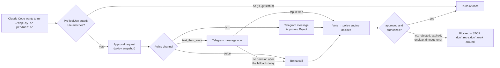

# Approval Line

**Your coding agent asks a human first, by Telegram or by phone.**

When an agent reaches a consequential action (a production deploy, a `git push`, a
recursive delete), Approval Line stops it and files an approval request. The
organization's policy (unanimous or quorum, vetoes, backups, deadlines) decides the
request from the approvers' answers: a tap on a Telegram button, or a spoken answer on a
Bolna phone call. The policy engine decides, never the agent, the caller or a voice model.
The agent only proceeds when the request is `approved` **and** `evaluation.authorized` is
`true`. Anything else means "do not run".

## 60-second demo

> **Demo video:** https://drive.google.com/file/d/1_cFl4qds9Hift4Mg6TgvyUcj252O1S7J/view?usp=drive_link



1. You ask Claude Code to deploy.
2. The guard blocks the command and files a request.
3. Your phone buzzes (Telegram) or rings (Bolna).
4. You approve: the command runs. You reject, or nobody answers: it stays blocked, and
   Claude reports the request ID and stops.

## 5-minute quickstart (mock mode: no phone, no Telegram)

This assumes Windows PowerShell, Python 3.12, Node.js 20+, Claude Code, and PostgreSQL 14+
with two empty databases: a dev database and a test database whose name contains `test`.
In mock mode nobody is called. You play the approver from the command line, and each
answer still goes through the real webhook, job queue and policy engine.

_Every command below exists and was checked against the code. A from-scratch run on a
fresh machine has not been done._

```powershell
git clone <this repo> approval-line; cd approval-line
python -m venv env; .\env\Scripts\Activate.ps1
cd backend; pip install -e ".[dev]"; Copy-Item .env.example .env
# Edit backend\.env: DATABASE_URL, TEST_DATABASE_URL, VOICE_PROVIDER=mock,
# VOICE_MOCK_STATE_DIR=./.mock_voice and VOICE_WEBHOOK_TOKEN = the output of:
python -c "import secrets; print(secrets.token_urlsafe(32))"
cd ..\frontend; npm ci; cd ..

.\scripts\start-demo.ps1 -Migrate            # API :8000, worker, dashboard :5173

cd backend
python -m app.cli create-org --name "Demo"                      # prints the org id
python -m app.cli demo-seed --org-id <org id> --yes             # demo approvers + policies
python -m app.cli create-dashboard-user --org-id <org id> --email you@example.com --name "You" `
  --scopes "approvers:read,approvers:write,audit:read,policies:read,policies:write,requests:create,requests:read,voice:calls:create,voice:calls:read"
```

1. Sign in at http://127.0.0.1:5173. Open the policy **Demo: production deploys**, tick
   **Auto-dial approvers** and save.
2. Connect Claude Code. You never set an environment variable by hand: this writes a
   git-ignored `demo-target/.claude/settings.local.json` with a least-privilege key.
   ```powershell
   python -m app.cli connect-claude --project demo-target --policy-id <policy id> --no-doctor
   ```
3. In a new window, run `cd demo-target; claude`, then ask: *"Deploy to production by
   running ./deploy.sh production."* The guard blocks the command, and two calls appear on
   the request page in the dashboard.
4. Answer as each approver (from `backend/`):
   ```powershell
   python -m app.cli voice-simulate --call-id <call id> --decision approve   # or reject
   ```
   After both approvals the deploy runs and writes a record to `demo-target/output/`.
   One rejection blocks it. Stop everything with `.\scripts\stop-demo.ps1`.

Text approvals can be simulated the same way (`TEXT_PROVIDER=mock` and
`app.cli text-simulate`); see [backend/docs/text-telegram.md](backend/docs/text-telegram.md).

## Connect your devices

### Claude Code
From `backend/`, run
`python -m app.cli connect-claude --project demo-target --policy-id <id>`. It checks that
the API is up and the policy is active with auto-dial on. It then issues a key with only
`requests:create, requests:read, policies:read`, writes `settings.local.json` and
`guard-rules.json` (it refuses unless both are git-ignored), and runs the read-only doctor.
Restart Claude Code afterwards. Details: [demo-target/README.md](demo-target/README.md).

### Phone (Bolna)
1. Set `VOICE_PROVIDER=bolna`, plus the Bolna API key, the agent ID and the extraction
   names in `backend/.env`. Create the agent as described in
   [backend/docs/voice-bolna.md](backend/docs/voice-bolna.md).
2. `start-demo.ps1` opens a Cloudflare quick tunnel and prints the webhook URL to paste
   into Bolna.
3. Set `VOICE_RECONCILE_AFTER_SECONDS=30`. A stale webhook URL then only delays a decision:
   the worker polls Bolna for it.

### Telegram
1. In Telegram, open **@BotFather**, send `/newbot` and copy the token.
2. In `backend/.env`, set `TEXT_PROVIDER=telegram`, `TELEGRAM_BOT_TOKEN`,
   `TELEGRAM_BOT_USERNAME` and `TEXT_CALLBACK_SECRET`. Generate the secret with the same
   `secrets.token_urlsafe(32)` command as above. Restart with `start-demo.ps1`, which then
   also starts the text worker.
3. **Pitfall:** `TELEGRAM_BOT_USERNAME` must be the bot's real username, which always ends
   in `bot` (for example `MyApprovalsBot`), not its display name. With the wrong name,
   pairing links open somebody else's account and pairing silently never completes.
   `pair-telegram` and the doctor now check the name with Telegram (`getMe`) and tell you
   the right one.
4. Pair each approver. Open the printed one-time link (valid 10 minutes) on the
   approver's phone and press **Start**; the bot replies "Linked to <name>".
   ```powershell
   python -m app.cli pair-telegram --approver-id <approver id>
   ```
5. Choose the channel for a policy:
   ```powershell
   python -m app.cli set-channel --policy-id <id> --channel text              # Telegram only
   python -m app.cli set-channel --policy-id <id> --channel text_then_voice --fallback-seconds 10
   python -m app.cli set-channel --policy-id <id> --channel voice             # back to calls
   ```
6. Run `.\scripts\demo-doctor.ps1` for a read-only go/no-go check. It sends nothing and
   places no calls.

## Security model

- **Fail closed.** The guard runs every risky command only after an approval that passes
  its check for that exact command. Every other outcome blocks: rejection, timeout, an
  unclear answer, the backend down, a bad configuration, missing hook input. Block
  messages tell the agent to stop, not retry or work around.
- **Decisions come only from verified approvers.**
  - A Telegram tap counts only from the Telegram account paired with that approver, in its
    own private chat, on that message.
  - A call result is re-fetched from Bolna with our own key; a webhook body is never
    trusted.
  - Free-text Telegram replies are never counted.
- **Signed, single-use, expiring buttons.**
  - Each button carries an HMAC that binds the action to a random nonce, so swapping
    Reject for Approve breaks it. Only the nonce's hash is stored.
  - A button works once, in the right stage, until the earlier of its time-to-live and
    the request deadline.
  - Approve needs a second "Confirm approve" tap.
- **The policy engine decides.** Taps and calls only submit votes. One function computes
  every decision from a policy snapshot frozen when the request was created. The first
  valid vote per seat wins; a conflicting second vote is refused and audited.
- **Audit trail.** Every request, prompt, tap, call, vote, decision and pairing goes to an
  insert-only log (a database trigger blocks updates and deletes). The log stores no
  tokens, phone numbers or Telegram IDs.
- **The dashboard cannot vote.** It has no voting control, and its users can never hold
  the `votes:write` scope. Agent keys can file and read requests, never vote.
- **Secrets stay out of output.** The tools report keys and tokens as PRESENT/ABSENT only.
  HTTP client request logging is suppressed because Telegram puts the bot token in every
  URL.

## Limitations

- **The guard is pattern matching, not a sandbox.** It applies regular expressions to
  the command text of Claude Code's Bash and PowerShell tools. An alias, an indirect
  script or another tool will not match. Real protection belongs in the deploy pipeline.
- **Bolna trial accounts can only call verified numbers.** An unverified number makes
  Bolna refuse the call, and the request stays pending.
- **Decisions are yes / no / conditional only.** Telegram offers approve and reject. A
  conditional approval is voice only and never approves by itself.
- **Claude Code only, for now.** The REST API and the MCP server are agent-agnostic, but
  only the Claude Code guard has been built.
- **Local only.** A deployment guide exists ([backend/docs/deployment.md](backend/docs/deployment.md))
  but hasn't been exercised. Voice identity is "Am I speaking with X?" plus the dialled
  number, with no voiceprint or PIN.

## Status

| Part | Verified |
|---|---|
| Voice approve and reject through the Claude Code guard (Bolna) | **Live**, 2026-10-29, and again in a rehearsal using the `connect-claude` setup. About 2 minutes from request to decision |
| Voice: unclear answer, declined call, unconfirmed identity (none become a vote) | **Live**, 2026-10-29 |
| Telegram approve and reject | **Live**, 2026-11-04: about 20 s (approve) and 26 s (reject) from request to decision |
| Telegram security checks (wrong sender, replay, expiry, tampering, wrong chat, ...) | Mock (automated tests) |
| `text_then_voice` (Telegram first, call after the fallback delay) | Mock (automated tests); not yet rehearsed live |
| Quorum/veto, conditions, deadlines, escalation, audit timeline | Mock; live calls covered single-approver policies only |
| Dashboard, MCP server, demo agent, idempotency, demo tooling | Mock |

**Roadmap:** Slack approvals, guards for other agents (any MCP client, CI pipelines), and a
hosted deployment.

More: [backend/README.md](backend/README.md) (setup, API, tests),
[backend/docs/](backend/docs/) (voice, text, policies, guard, security),
[demo-target/REHEARSAL.md](demo-target/REHEARSAL.md) (rehearsal checklist and rollback).
